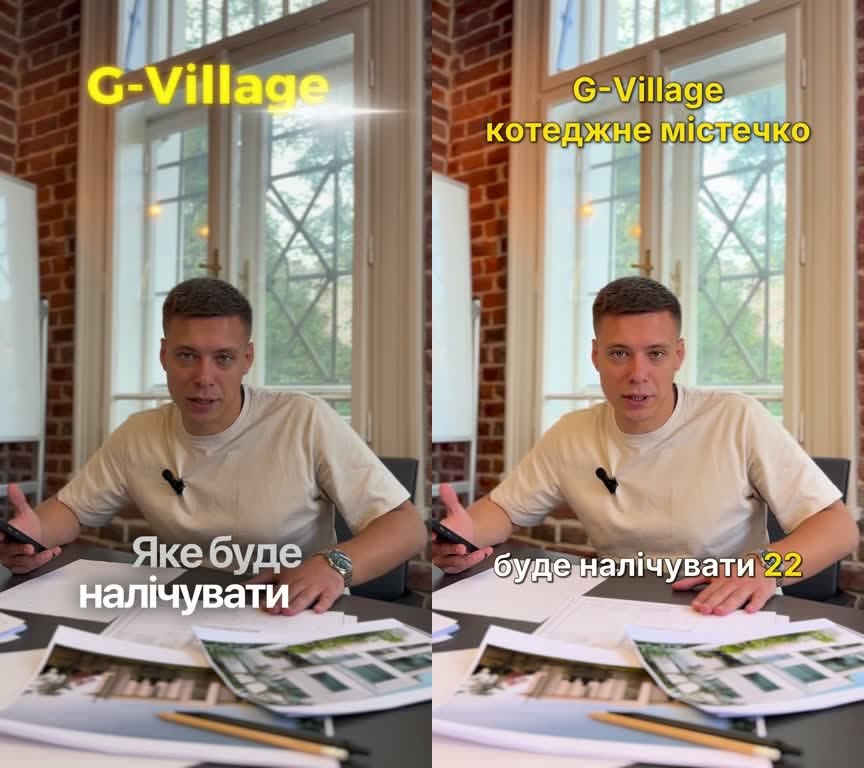
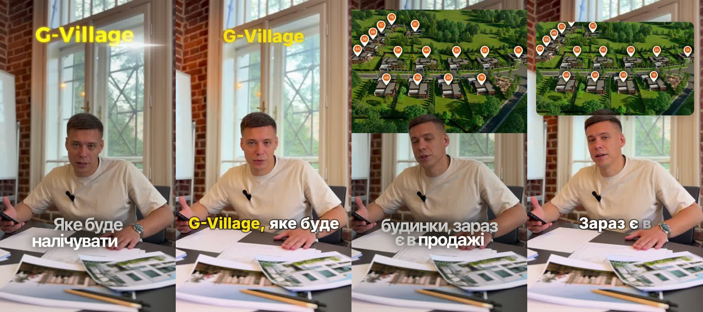
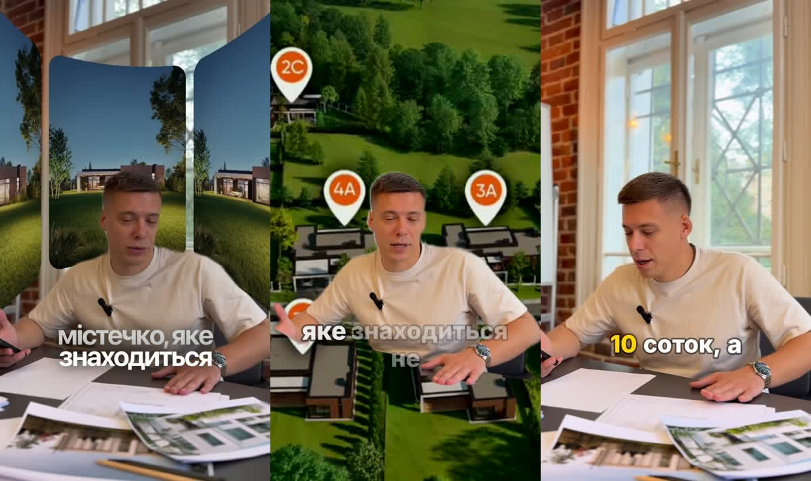

# Findings from the first experiments

Date: 2026-10-10. One pair of files: the raw clip `IMG_7821.MOV` and the finished video made from it by hand, `IMG_8318.MOV` (the reference). All numbers below were measured by `lab/lab.py` in the lab container (Docker on an M4 Pro, CPU only, 14 cores, 8 GB given to the VM). One clip is a small sample: treat every conclusion as "true for this clip" until more footage is run.

## What the reference shows she does

| | Raw | Reference |
|---|---|---|
| Length | 40.7 s | 37.6 s |
| Picture | HEVC 10-bit HDR (HLG, Dolby Vision), 1920x1080 stored sideways with a rotate flag, frame rate drifting around 30 | HEVC 8-bit ordinary colour, 1080x1920, exactly 30 fps |
| Loudness | -38.2 LUFS, peak -16.7 dB | -15.6 LUFS, peak -1.1 dB |
| Loudness range | 8.1 LU | 3.5 LU |
| Sound | mono 48 kHz | stereo 44.1 kHz |

Seen in the frames (one frame per second; an earlier version of this page looked at two frames and missed most of this):

- **inserts tied to what is being said**: at 2.6-5.4 s ("котеджне містечко...") the speaker is cut out of his background and renders of the houses stand behind him in curved frames; at 13.9-16.8 s ("...в продажі доступних 15 будинків") an aerial picture of the settlement with map pins sits over the top of the frame;
- **a title that arrives on cue**: "G-Village" in yellow with a glow and a light sweep, from about 11 s, when the name is spoken, to about 14 s;
- **changes of framing**: seven scene changes in a clip whose raw take has none, including closer framing on some phrases;
- **added sound**: the raw recording is mono; the result is stereo with content that differs between the channels, so music or effects were mixed in;
- **subtitles**: two or three words at a time, bold white with a shadow, numbers and names in yellow, the words lighting up as they are spoken, lines of different sizes;
- colour is left almost as shot.

What she cut: the silent tail. The speech ends at 37.95 s of a 40.7 s take, and her video is 37.6 s. The transcripts of the two files are word for word the same. **She did not cut pauses inside this take.**

Correction: an earlier version of this page said she also dropped a closing sentence, "Дякую за перегляд!". Nobody says it. The recogniser invented it in the silence after the speech, as three words squeezed into zero time; it is a well-known habit of this model. The engine now drops words with no duration and words that begin after the sound has stopped (`engine/speech.py`).

**The lab's automatic output has none of the montage.** It levels the sound, trims the tail and adds subtitles and a title. That is the routine layer of her work, not what makes the video lively.

## Hypotheses

| # | Hypothesis | Verdict | Evidence |
|---|---|---|---|
| H0 | Her phone footage can be processed without surprises | **Yes, with care** | HDR, rotation and a drifting frame rate are all present. Tone-mapped to ordinary colour and constant 30 fps: 9.0 s for 40.7 s of video (4.5x real time), length unchanged to the millisecond, colour close to her result (ours slightly brighter). |
| H1 | Sound can be cleaned no worse than her app | **Levelling: yes. Denoising: not shown yet** | Levelling alone takes the clip from -38 to about -16 LUFS in half a second. Three denoisers on top (spectral 0.6 s, RNNoise 0.7 s, DeepFilterNet 5.5 s for the whole clip) measure within a decibel of levelling alone on this clip, which was recorded in a quiet room with a lapel mic. Whether any of them *sounds* better needs ears, and a noisy clip. Files to listen to: `out/IMG_7821.voice.*.wav`. |
| H2 | Stabilisation is good enough | **Not testable on this clip** | Shot on a tripod. The two-pass stabiliser runs and writes a side-by-side file (`out/IMG_7821.stable.mp4`), but there is nothing to judge. Needs a walking shot. |
| H3 | Ukrainian subtitles come out nearly ready | **Yes** | `large-v3-turbo` on CPU: language detected as Ukrainian (0.99), 89 words, one word marked unsure, 27-29 s for 40.7 s of speech (1.5x real time), plus a one-time 33 s to load the model. "G-Village", "22 будинки", "150 метрів квадратних" are right. One invented sentence at the very end ("Дякую за перегляд!", in the silence after the speech), now filtered out. The village name is heard as "Горанч" in the raw file and "Гаранч" in the reference: proper names need a person to confirm. |
| H4 | Pauses can be cut automatically | **Mechanically yes; not what this clip needed** | The speaker talks without pauses; the longest gap between words is 0.44 s. A fixed-threshold silence detector reported 11 "pauses" in the raw file only because the recording is 22 dB too quiet: silence must be judged relative to the speech level (or by a voice detector), never by an absolute threshold. The only cut this clip needed was the silent tail, which follows from the word timings. |
| H5 | Subtitles in her style, with the right words highlighted | **Content: yes. Look: not yet** | The AI (DeepSeek Flash, no thinking, 1.4-2.4 s, about 800 tokens) picked the same kind of words she highlights: 22, 15, 10, 150, the place names. It also proposed a title ("G-Village котеджі") and "corrected" the village name to "Горенка", which is a guess: AI corrections of names must be shown as suggestions, not applied silently. The look made with ffmpeg's subtitle renderer is plainer than hers (no word-by-word fill, no glow on the title). Our own canvas renderer from Plan Highlighter can draw exactly this; the subtitle renderer in ffmpeg cannot be pushed much further. |
| H6 | The whole chain saves real time | **Promising** | Raw file to subtitled, levelled, trimmed video in 40-44 s for a 40.7 s clip over two runs: about 29 s speech recognition, 1-1.4 s AI, 9-13 s render. The result is 1080x1920, 30 fps, -17.0 LUFS (hers: -15.6). That is machine time with no one at the screen. How long the same work takes her by hand is not known yet; that number decides this hypothesis. |
| H7 | Mac as the engine, phone as the remote | **Not tested** | Docker hung once when a container was given the Downloads folder (most likely a macOS permission prompt nobody saw) and had to be force-restarted. Media must live in a folder the engine owns, not in Downloads/Documents/Desktop. |
| H8 | Cutting the speaker out of the background | **Yes, on this clip** | Robust Video Matting (MobileNetV3) on CPU: 105 frames (3.5 s) in 18 s, computed at 432x768 and scaled up with a slight blur. Hair, shoulders and the hand are clean on a speaker in front of a window and a brick wall. It keeps the person only; her version also keeps the table in front of him. One clip, one speaker, a tripod shot. See `img/backdrop.jpg`. |
| H9 | The AI can plan the montage from the words and say what material it needs | **Promising** | Given only the numbered transcript (2.3 s, no thinking), the model proposed six beats and three requests for material. Two of its beats match hers closely: the title "G-Village" at 10.0-14.4 s (hers: about 11-14 s), and "a general view of the settlement, from above or from the street" behind the speaker at 14.6-17.6 s (hers: an aerial picture at 13.9-16.8 s). It missed her first insert at 2.6-5.4 s (the prompt told it to leave the opening alone) and added three beats she did not make (facades, a floor plan for "150 m²", a call-to-action title). Its requests were concrete and plausible: an overview of the settlement, facades of the single-storey houses, a plan of a 150 m² house (optional). One clip, one run. |

## What this changes in the plan

0. **Montage is half of the work, and it follows the words.** Every insert in the reference starts on the phrase it illustrates. So the transcript can drive not only the cut and the subtitles but also what appears in the frame and when. The pipeline cannot invent her pictures, but it can work out which ones it needs and ask for them (H9): a list of requests the author fulfils from her phone, after which the inserts fall into place.

1. **Text is the main interface.** Recognition is good enough that the transcript can drive everything: the cut (drop a sentence, as she did), the subtitles, the highlights, the title. This matters more than pause removal.
2. **Rendering belongs to our own engine.** Subtitles and titles in her style are overlays with timing, which is what Plan Highlighter's renderer already does; ffmpeg should decode, cut, mix and encode, not draw text.
3. **Speech recognition is the slow step**, about 70% of the time. On Apple hardware outside Docker it should be several times faster; inside Docker it is CPU-only. Worth measuring natively before deciding where the engine runs.
4. **AI suggestions need a review step.** Highlights are safe to apply by default; changes to words are not.
5. **Levelling is the audio feature**; denoising is an option to verify on noisy footage, not a headline.
6. **Unknowns that need more footage:** a walking shot (stabilisation), a noisy location (denoising), a take with real pauses and retakes (cutting), an interview with two voices.

## Side by side

Left: her finished video. Right: the lab's output from the raw file, with no manual step.

On this frame the words, the highlighted number and the title are there, and what differs is the finish: her subtitles fill in word by word and sit larger and lower, and her title has a glow and a light sweep. **This frame flatters the lab.** Over the whole video hers also has two inserts, changes of framing and added sound, none of which the lab produces (see the top of this page).

## First render from the engine (milestone 1, in progress)

`./reel new` then `./reel render`, with one request answered by a stand-in picture (a crop of the aerial view from her own finished video). In each pair: hers on the left, the engine's on the right.

- The AI planned, from the words alone, a title "G-Village" at 10.8 s (hers: about 11 s) and a view of the settlement from above at 13.4-17.6 s (hers: 13.9-16.8 s). It asked for exactly that picture: "a photo or video of the settlement from above".
- Subtitles are drawn by the engine's own renderer: a phrase at a time, each word turning solid as it is spoken, key words in the accent colour.
- Machine time for this 38 s video: about 32 s to transcribe, 2-3 s for the AI, 21-24 s to render (Docker, CPU only).

Not there yet: her opening insert (the speaker cut out over renders of the houses), her closer framing on some phrases beyond the one zoom the AI chose, the added music or effects, and the finer points of her look (her picture fills the top of the frame edge to edge; her title has a stronger glow). Nobody but the author of this page has judged the result.

## Backdrop and zoom

Left: her opening insert. Middle: the engine's backdrop on the same words, with the stand-in picture. Right: the engine's zoom on a key phrase.

Her insert shows several renders in curved frames in the upper part and keeps the table; ours fills the frame with one picture behind the cut-out speaker. The mechanism is there; the layout of the insert is a style to add.
